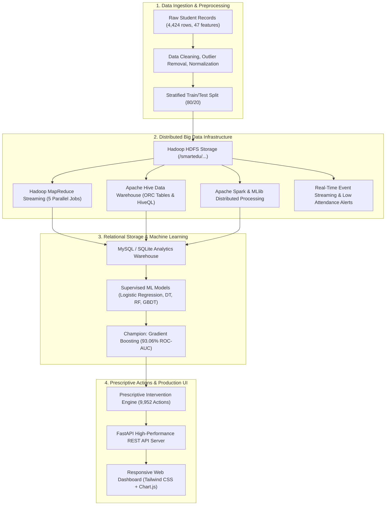

# SmartEdu Analytics 🎓
### Big Data-Driven Student Performance Analysis and Dropout Risk Prediction System

[](https://www.python.org/)
[](https://fastapi.tiangolo.com/)
[](https://hadoop.apache.org/)
[](https://hive.apache.org/)
[](https://spark.apache.org/)
[](https://scikit-learn.org/)
[](https://tailwindcss.com/)
[](LICENSE)

---

## 📌 Executive Summary

**SmartEdu Analytics** is an end-to-end Big Data Analytics and Machine Learning engineering platform designed to analyze student academic trajectories, attendance patterns, and socioeconomic indicators. The system proactively detects learning difficulties and predicts dropout risk at an early stage, delivering personalized prescriptive interventions to academic advisors and department heads.

Built across **10 distinct engineering phases**, it combines distributed cluster computing (Hadoop HDFS, MapReduce, Apache Hive, Apache Spark, Real-time Event Streaming) with supervised Machine Learning (Champion: **Gradient Boosting with 93.06% ROC-AUC**), an automated recommendation engine (**9,952 targeted interventions**), and a production-grade full-stack web dashboard (FastAPI + Tailwind CSS Single-Page Application).

---

## 🏗️ System Architecture



---

## 📋 Comprehensive 10-Phase Implementation

| Phase | Core Domain | Technologies Used | Key Deliverables & Achievements |
|---|---|---|---|
| **Phase 1** | **Dataset Collection & Preprocessing** | Pandas, NumPy, Matplotlib, Seaborn | Real-world higher education dataset (4,424 students, 47 features). Imputation, encoding, stratified train/test split. 6 EDA figures generated. |
| **Phase 2** | **Hadoop HDFS Storage & Ingestion** | Hadoop 2.6.0, HDFS, Bash | Dedicated namespaces (`/smartedu/{raw, processed, analytics, reports}`), block replication verification, cluster health check automation. |
| **Phase 3** | **Hadoop MapReduce Analytics** | Hadoop Streaming, Python Mappers/Reducers | 5 distributed streaming jobs: Course GPA averages, Attendance analysis, Performance classification, Subject failure distribution, and Risk index. |
| **Phase 4** | **Apache Hive Data Warehousing** | Apache Hive 1.1.0, HiveQL, HDFS | `smartedu` database, external table `students_ext`, course dimension joins, ORC-optimized warehouse tables, 14 analytical queries. |
| **Phase 5** | **MySQL Database Integration** | MySQL / SQLite, SQLAlchemy, PyMySQL | Relational schema with 3NF normalization, automated views (`v_student_risk_summary`), full CRUD operational API with test coverage. |
| **Phase 6** | **Apache Spark & MLlib** | PySpark, Spark DataFrames, Spark MLlib | Large-scale DataFrame transformations, Spark SQL queries, and distributed Random Forest classifier (87.57% test accuracy, 0.9258 ROC-AUC). |
| **Phase 7** | **Real-Time Event Streaming** | Python Streaming Pipeline, JSON Stream | Real-time academic event simulation, sliding-window consumer, duplicate event suppression, automated threshold trigger (<75% attendance). |
| **Phase 8** | **Dropout Risk ML Prediction** | Scikit-Learn, Joblib, Gradient Boosting | Supervised ML benchmark across 4 algorithms. **Champion: Gradient Boosting (93.06% ROC-AUC, 88.70% Accuracy)**. 4,424 records scored into risk tiers. |
| **Phase 9** | **Recommendation Engine** | Python Rule Engine, Relational DB | Domain-driven intervention system generating **9,952 prioritized recommendations** (Critical, High, Medium, Low) across academic, financial, and attendance domains. |
| **Phase 10** | **Production Full-Stack Dashboard** | FastAPI, Uvicorn, Tailwind CSS, Chart.js | Production REST API with 9 endpoints and 100% test pass rate. Interactive Single-Page Application (SPA) dashboard with real-time analytics. |

---

## 🤖 Machine Learning Model Benchmarks (Phase 8)

| Algorithm | Test Accuracy | Precision | Recall | F1-Score | ROC-AUC | Status |
|---|:---:|:---:|:---:|:---:|:---:|:---:|
| **Gradient Boosting (GBDT)** | **88.70%** | **88.42%** | **88.70%** | **88.49%** | **93.06%** | 🏆 **Champion** |
| Random Forest (RF) | 88.14% | 87.79% | 88.14% | 87.89% | 92.48% | Runner-up |
| Logistic Regression | 87.01% | 86.53% | 87.01% | 86.69% | 91.80% | Baseline |
| Decision Tree (CART) | 81.69% | 81.76% | 81.69% | 81.73% | 79.52% | Baseline |

---

## 🚀 Quickstart & Setup Guide

### 1. Prerequisites
- Python 3.10 or higher
- Git

### 2. Setup Virtual Environment & Install Dependencies
```bash
# Navigate to project directory
cd SmartEduAnalytics

# Create and activate Python virtual environment
python -m venv .venv

# On Windows:
.venv\Scripts\activate
# On Linux/macOS:
source .venv/bin/activate

# Install required dependencies
pip install -r requirements.txt
```

### 3. Launch Master Pipeline
```bash
python run_all.py
```

### 4. Production Web Dashboard
Navigate to:
- **Web Dashboard**: [`http://127.0.0.1:8000/`](http://127.0.0.1:8000/)
- **Swagger REST API Docs**: [`http://127.0.0.1:8000/docs`](http://127.0.0.1:8000/docs)

---

## 📄 License
This project is licensed under the MIT License - see the [LICENSE](SmartEduAnalytics/LICENSE) file for details.
