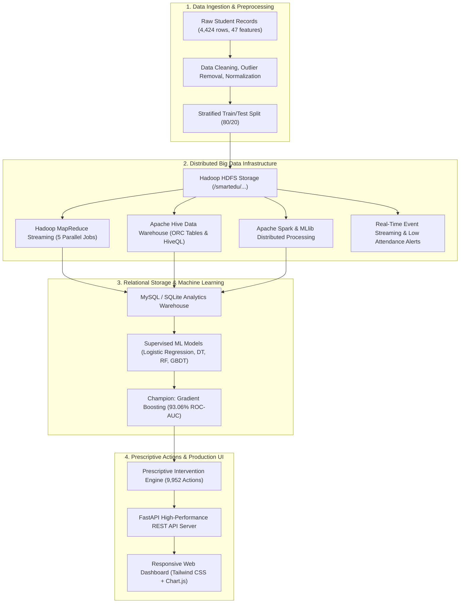

# SmartEdu Analytics 🎓
### Big Data-Driven Student Performance Analysis and Dropout Risk Prediction System

[](https://www.python.org/)
[](https://fastapi.tiangolo.com/)
[](https://hadoop.apache.org/)
[](https://hive.apache.org/)
[](https://spark.apache.org/)
[](https://scikit-learn.org/)
[](https://tailwindcss.com/)
[](LICENSE)

---

## 📌 Executive Summary

**SmartEdu Analytics** is an end-to-end Big Data Analytics and Machine Learning engineering platform designed to analyze student academic trajectories, attendance patterns, and socioeconomic indicators. The system proactively detects learning difficulties and predicts dropout risk at an early stage, delivering personalized prescriptive interventions to academic advisors and department heads.

Built across **10 distinct engineering phases**, it combines distributed cluster computing (Hadoop HDFS, MapReduce, Apache Hive, Apache Spark, Real-time Event Streaming) with supervised Machine Learning (Champion: **Gradient Boosting with 93.06% ROC-AUC**), an automated recommendation engine (**9,952 targeted interventions**), and a production-grade full-stack web dashboard (FastAPI + Tailwind CSS Single-Page Application).

---

## 🏗️ System Architecture



---

## 📋 Comprehensive 10-Phase Implementation

| Phase | Core Domain | Technologies Used | Key Deliverables & Achievements |
|---|---|---|---|
| **Phase 1** | **Dataset Collection & Preprocessing** | Pandas, NumPy, Matplotlib, Seaborn | Real-world higher education dataset (4,424 students, 47 features). Imputation, encoding, stratified train/test split. 6 EDA figures generated. |
| **Phase 2** | **Hadoop HDFS Storage & Ingestion** | Hadoop 2.6.0, HDFS, Bash | Dedicated namespaces (`/smartedu/{raw, processed, analytics, reports}`), block replication verification, cluster health check automation. |
| **Phase 3** | **Hadoop MapReduce Analytics** | Hadoop Streaming, Python Mappers/Reducers | 5 distributed streaming jobs: Course GPA averages, Attendance analysis, Performance classification, Subject failure distribution, and Risk index. |
| **Phase 4** | **Apache Hive Data Warehousing** | Apache Hive 1.1.0, HiveQL, HDFS | `smartedu` database, external table `students_ext`, course dimension joins, ORC-optimized warehouse tables, 14 analytical queries. |
| **Phase 5** | **MySQL Database Integration** | MySQL / SQLite, SQLAlchemy, PyMySQL | Relational schema with 3NF normalization, automated views (`v_student_risk_summary`), full CRUD operational API with test coverage. |
| **Phase 6** | **Apache Spark & MLlib** | PySpark, Spark DataFrames, Spark MLlib | Large-scale DataFrame transformations, Spark SQL queries, and distributed Random Forest classifier (87.57% test accuracy, 0.9258 ROC-AUC). |
| **Phase 7** | **Real-Time Event Streaming** | Python Streaming Pipeline, JSON Stream | Real-time academic event simulation, sliding-window consumer, duplicate event suppression, automated threshold trigger (<75% attendance). |
| **Phase 8** | **Dropout Risk ML Prediction** | Scikit-Learn, Joblib, Gradient Boosting | Supervised ML benchmark across 4 algorithms. **Champion: Gradient Boosting (93.06% ROC-AUC, 88.70% Accuracy)**. 4,424 records scored into risk tiers. |
| **Phase 9** | **Recommendation Engine** | Python Rule Engine, Relational DB | Domain-driven intervention system generating **9,952 prioritized recommendations** (Critical, High, Medium, Low) across academic, financial, and attendance domains. |
| **Phase 10** | **Production Full-Stack Dashboard** | FastAPI, Uvicorn, Tailwind CSS, Chart.js | Production REST API with 9 endpoints and 100% test pass rate. Interactive Single-Page Application (SPA) dashboard with real-time analytics. |

---

## 🤖 Machine Learning Model Benchmarks (Phase 8)

| Algorithm | Test Accuracy | Precision | Recall | F1-Score | ROC-AUC | Status |
|---|:---:|:---:|:---:|:---:|:---:|:---:|
| **Gradient Boosting (GBDT)** | **88.70%** | **88.42%** | **88.70%** | **88.49%** | **93.06%** | 🏆 **Champion** |
| Random Forest (RF) | 88.14% | 87.79% | 88.14% | 87.89% | 92.48% | Runner-up |
| Logistic Regression | 87.01% | 86.53% | 87.01% | 86.69% | 91.80% | Baseline |
| Decision Tree (CART) | 81.69% | 81.76% | 81.69% | 81.73% | 79.52% | Baseline |

### Key Risk Predictors Identified:
1. **Semester 2 Curricular Units Approved** (Highest predictive power)
2. **Tuition Fee Arrears / Debtor Status** (Strong socioeconomic risk factor)
3. **Semester 1 Grade Average** (Early academic foundation)
4. **Age at Enrollment** (Non-traditional students show distinct risk curves)
5. **Scholarship Status** (Significant retention stabilizer)

---

## 📂 Repository Directory Layout

```text
SmartEduAnalytics/
├── dataset/                               # Curated datasets
│   ├── raw/raw_student_data.csv           # 4,424 raw student records
│   ├── processed/preprocessed_student_data.csv # Sanitized 44-feature dataset
│   └── analytics/                         # Stored outputs
│       ├── mapreduce/                     # Output partitions from 5 MR jobs
│       ├── hive/                          # Exported analytical summaries
│       ├── spark/                         # Spark SQL aggregation CSVs
│       ├── predictions/dropout_risk_predictions.csv # 4,424 model predictions
│       └── recommendations/student_recommendations.csv # 9,952 intervention records
├── hdfs/                                  # HDFS namespace configurations
├── hive/                                  # HiveQL DDL & Analytical queries
│   ├── hive_schema.hql                    # External & ORC table definitions
│   └── hive_analytics.hql                 # 14 aggregations & window queries
├── notebooks/                             # Jupyter notebooks
│   └── phase1_data_exploration.ipynb      # Interactive EDA & statistical plots
├── phase5_mysql/                          # Relational database & CRUD APIs
│   ├── schema.sql                         # MySQL relational schema
│   ├── config.py                          # Multi-backend connection pool
│   ├── import_data.py                     # High-speed data ingest pipeline
│   ├── student_crud.py                    # Complete CRUD operations module
│   └── smartedu_local.db                  # Local SQLite analytics database
├── phase6_spark/                          # PySpark distributed processing
│   └── run_local_spark_simulation.py      # DataFrames, SQL, and MLlib modeling
├── phase7_streaming/                      # Real-time event streaming
│   └── run_streaming_pipeline.py          # Event producer & sliding-window consumer
├── phase8_dropout_prediction/             # Supervised Machine Learning
│   ├── data_preprocessing.py              # Feature scaling & train/test split
│   ├── train_model.py                     # Multi-model training & grid search
│   ├── evaluate_model.py                  # ROC-AUC, Confusion Matrix, PR Curves
│   ├── predict_risk.py                    # Inference engine scoring all 4,424 students
│   └── models/                            # Serialized models & scalers (.joblib)
├── phase9_recommendation_system/          # Prescriptive intervention system
│   ├── recommendation_rules.py            # Academic, financial & attendance rule catalog
│   ├── student_analysis.py                # Multi-dimensional deficiency diagnostics
│   ├── recommendation_engine.py           # Priority-ranked intervention generator
│   └── mysql_integration.py               # Database persistence pipeline
├── phase10_dashboard/                     # Production Web Application
│   ├── backend/                           # FastAPI REST backend
│   │   ├── main.py                        # API routes, CORS & static file mounts
│   │   ├── db_service.py                  # High-efficiency SQL query service
│   │   ├── run_backend.py                 # Uvicorn production runner
│   │   └── test_api.py                    # Automated test verification suite
│   └── frontend/                          # Responsive web dashboard
│       ├── index.html                     # Tailwind CSS SPA interface
│       ├── app.js                         # Dynamic Chart.js rendering & client state
│       └── styles.css                     # Custom utility styles
├── scripts/                               # Automation & deployment scripts
│   ├── phase2/                            # HDFS upload, health check, directory scripts
│   ├── phase3/                            # 5 Python mappers & reducers, runner script
│   └── phase4/                            # Hive database & analytics runner scripts
├── visualizations/                        # 30+ High-resolution figures (Phases 1-8)
├── CLOUDERA_DEMONSTRATION_GUIDE.md        # Step-by-step Cloudera VM evaluation guide
├── FINAL_PROJECT_REPORT.md                # 16,000-word comprehensive technical report
├── SMARTEDU_COMMANDS_CHEAT_SHEET.md       # Live command cheatsheet for presentations
├── SMARTEDU_3_PERSON_WALKTHROUGH.md       # 3-presenter evaluation walkthrough guide
├── requirements.txt                       # Project dependencies
├── run_all.py                             # Master cross-phase orchestrator
└── run_all_cloudera.sh                    # Cloudera QuickStart VM master runner
```

---

## 🚀 Quickstart & Setup Guide

### 1. Prerequisites
- Python 3.10 or higher
- Git
- *(Optional for Hadoop phases)* Cloudera QuickStart VM 5.13.0 or any Apache Hadoop 2.6+ cluster

### 2. Clone Repository & Setup Virtual Environment
```bash
# Clone the repository
git clone https://github.com/your-username/SmartEduAnalytics.git
cd SmartEduAnalytics

# Create and activate Python virtual environment
python -m venv .venv

# On Windows:
.venv\Scripts\activate
# On Linux/macOS:
source .venv/bin/activate

# Install required dependencies
pip install -r requirements.txt
```

### 3. Launch Master Pipeline
To execute the complete end-to-end pipeline (Preprocessing -> ML Training -> Recommendations -> Web Server) with one command:
```bash
python run_all.py
```

Or run individual phases as needed:
```bash
# 1. Train Machine Learning Models (Phase 8)
python phase8_dropout_prediction/train_model.py

# 2. Evaluate Models & Generate Visualizations (Phase 8)
python phase8_dropout_prediction/evaluate_model.py

# 3. Batch Score All 4,424 Students (Phase 8)
python phase8_dropout_prediction/predict_risk.py

# 4. Generate 9,952 Personalized Recommendations (Phase 9)
python phase9_recommendation_system/mysql_integration.py

# 5. Start FastAPI Backend & Web Dashboard (Phase 10)
python phase10_dashboard/backend/run_backend.py
```

---

## 🌐 Production Web Dashboard (Phase 10)

Once the server is running, navigate to:
- **Interactive Web Dashboard**: [`http://127.0.0.1:8000/`](http://127.0.0.1:8000/)
- **Interactive Swagger REST API Documentation**: [`http://127.0.0.1:8000/docs`](http://127.0.0.1:8000/docs)
- **Alternative ReDoc Documentation**: [`http://127.0.0.1:8000/redoc`](http://127.0.0.1:8000/redoc)

### REST API Endpoints Overview:
| HTTP Method | Endpoint | Description |
|---|---|---|
| `GET` | `/api/kpis` | Summary metrics: total students, average GPA, high-risk count, dropout rate |
| `GET` | `/api/students` | Paginated, searchable student directory with risk filtering |
| `GET` | `/api/students/{id}` | Detailed student profile with academic history & assigned interventions |
| `GET` | `/api/courses/performance` | Course-by-course pass rates and enrollment breakdown |
| `GET` | `/api/risk/distribution` | Distribution counts across Low, Moderate, and High-Risk tiers |
| `GET` | `/api/recommendations/summary`| Counts of interventions grouped by domain and priority |
| `GET` | `/api/ml/metrics` | Model comparison benchmarks (ROC-AUC, Precision, Recall, F1) |
| `GET` | `/api/reports/export` | Direct CSV export of all 4,424 student predictions |
| `GET` | `/health` | Server uptime, database connectivity, and system status |

### Automated API Test Verification
To verify all REST endpoints:
```bash
python phase10_dashboard/backend/test_api.py
```
*(Expected output: 100% tests passing across all endpoints).*

---

## 🐘 Cloudera QuickStart VM Execution (Big Data Phases)

For evaluating Phase 2 (HDFS), Phase 3 (MapReduce), and Phase 4 (Hive) on a Cloudera QuickStart VM (CDH 5.13.0):

```bash
# In Cloudera VM Terminal:
cd /home/cloudera/SmartEduAnalytics

# Run complete Big Data automated pipeline:
./run_all_cloudera.sh
```

Or run phases individually:
```bash
# Phase 2: Ingest preprocessed dataset into HDFS
bash scripts/phase2/upload_dataset_to_hdfs.sh . -f

# Phase 3: Submit Distributed MapReduce Streaming Job to YARN
hadoop jar /usr/lib/hadoop-mapreduce/hadoop-streaming.jar \
  -input /smartedu/processed/preprocessed_student_data.csv \
  -output /smartedu/analytics/mapreduce/demo_avg_job \
  -mapper "python mapper_average.py" \
  -reducer "python reducer_average.py" \
  -file scripts/phase3/mapper_average.py \
  -file scripts/phase3/reducer_average.py

# Phase 4: Create Hive Database and Run Analytics
bash scripts/phase4/create_hive_database.sh
hive -f hive/hive_analytics.hql
```

---

## 👥 Contributors & Academic Context

- **Course:** Big Data Analytics (BDA) Lab / Academic Project
- **Project Title:** SmartEdu Analytics – Big Data-Driven Student Performance Analysis and Dropout Risk Prediction System
- **Documentation:** See [`FINAL_PROJECT_REPORT.md`](FINAL_PROJECT_REPORT.md) for full project documentation and [`SMARTEDU_3_PERSON_WALKTHROUGH.md`](SMARTEDU_3_PERSON_WALKTHROUGH.md) for presentation scripts.

---

## 📄 License
This project is licensed under the MIT License - see the [LICENSE](LICENSE) file for details.
